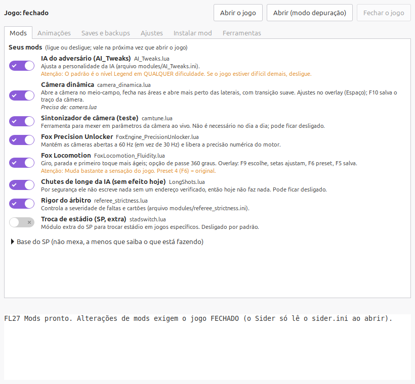
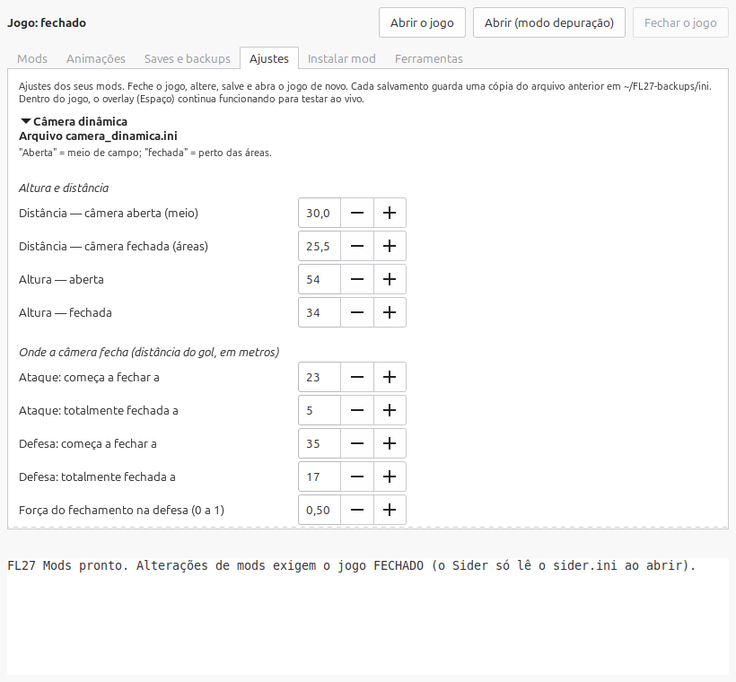
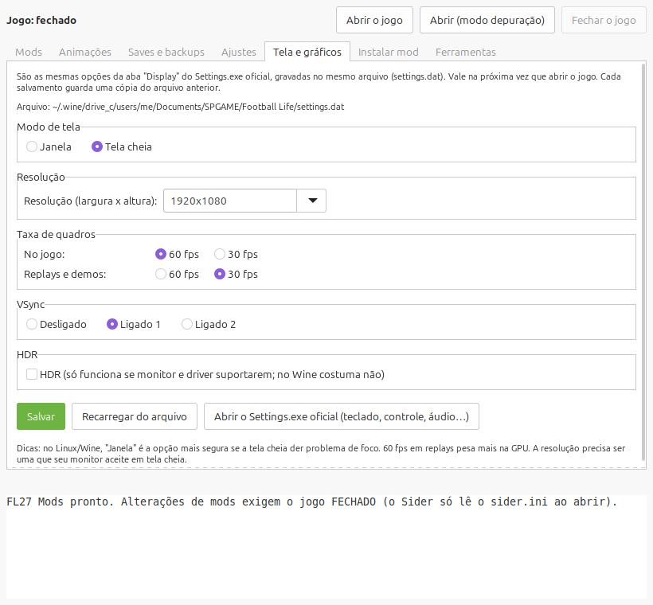
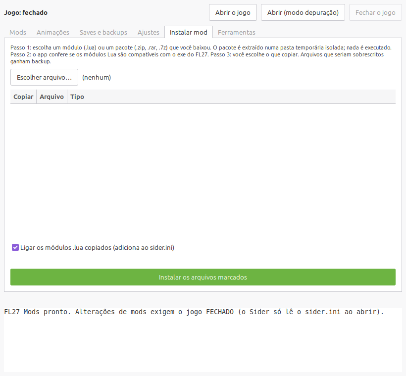

# FL27 Mods

A small GTK3 desktop app to manage **Sider/Lua mods** for *SP Football Life 2027* running on Linux (Wine / Proton / Lutris).
Instead of editing `sider.ini` by hand, you flip switches, tweak settings and install new mods from a window.

> The interface is in Brazilian Portuguese. Everything works the same regardless of language.
> Not affiliated with SP Football Life or Konami. Use at your own risk — every file the app changes is backed up first.



## What it does

| Tab | What you get |
|---|---|
| **Mods** | One switch per Lua module in `SiderAddons/modules`, with a description and warnings (descriptions live in `app/mods.json`). Dependencies are checked (e.g. a mod that needs `camera.lua`). Modules that ship with the SP base are tucked away in a collapsed section. |
| **Ajustes** (Settings) | Number fields for the config files of popular mods: dynamic camera, Fox Locomotion, AI personality (`AI_Tweaks.ini`), referee strictness presets. Comments in the files are preserved; the previous file is copied to the backup folder before every save. |
| **Tela e gráficos** (Display) | The same options as the *Display* tab of the official `Settings.exe`, edited in `settings.dat`: window / full screen, resolution (presets or any `WxH`), 30/60 fps in game and in replays, VSync (off / 1 / 2), HDR flag. Only the known bits/fields are written, the rest of the file is untouched, with a backup first. A button opens the official `Settings.exe` for keyboard / controller / audio. |
| **Instalar mod** (Install) | Pick a `.lua`, `.zip`, `.rar` or `.7z`. The archive is extracted into an isolated temp folder (path-traversal and symlinks are refused, nothing is executed), `scripts/verify_mod.py` checks whether the module's byte patterns exist in your exe, and you choose which files to copy. Updating an existing mod backs up the old `.lua` and **keeps your existing `.ini`/`.txt`** unless you tick them. Game data (`.cpk`, `.exe`, `.dll`) is never installed by the wizard. |
| **Saves e backups** | One-click save backup/restore (a restore also snapshots the state it replaces) and "revert to original". |
| **Animações** *(optional)* | Only shown if you set `ANIM_SCRIPT` — a script of your own that switches animation packs (`script fox\|ps9\|leve\|status`). |
| **Ferramentas** | Status report, open folders, guide. A freeze-diagnosis script (`scripts/diagnose_freeze.sh`) collects `gdb`/`strace` evidence while the game is hung. |

The header has **Open game**, **Open (debug)** and **Close game** buttons. While the game runs, all editing is disabled (Sider only reads `sider.ini` at startup).





## Requirements

* Linux, Python 3, GTK3 bindings (`sudo apt install python3-gi gir1.2-gtk-3.0` / `sudo dnf install python3-gobject gtk3`)
* SP Football Life 2027 with Sider already installed (the `SiderAddons` folder), run through Wine/Proton
* Optional: `unrar` and `7z` (for `.rar` / `.7z` mods), `gdb` and `strace` (freeze diagnosis)

## Install

```bash
git clone https://github.com/Guilherme-Cruz-Ferreira/fl27-mods.git
cd fl27-mods
./install.sh
```

`install.sh` finds your game (or asks), writes `~/.config/fl27-mods/config.env`, keeps a copy of the current `sider.ini` as the "original"
(used to separate your mods from the SP base — run it on a clean install if you can) and adds a **FL27 Mods** launcher to your menu.
You can also just run `python3 app/fl27_mods.py`; on first run it asks for the game folder.

Every path is configurable — see [`config.example.env`](config.example.env) (game folder, Wine/Proton `bin` dir, backup folders, save folder, …).

## Layout

```
app/        fl27_mods.py (window), fl27_extra.py (Settings + Install tabs), fl27paths.py (config), mods.json (descriptions)
scripts/    mod.sh (on/off/root-on/root-off/list/restaurar), backup_saves.sh, launch.sh [--debug], status.sh,
            revert_to_original.sh, open_settings.sh, diagnose_freeze.sh, verify_mod.py
tests/      run_tests.sh — builds a fake install in a temp dir and checks scripts and file helpers (no game needed)
```

The window has no file logic of its own: it calls the scripts, which are also usable from a terminal
(`scripts/mod.sh list`, `scripts/mod.sh on camera.lua`, …).

## Tests

```bash
tests/run_tests.sh
python3 app/fl27_mods.py --selftest
```

## Status / known limits

* Developed and used on one machine (Lutris GE-Proton/Wine). Other setups should work through `config.env` but are untested — issues welcome.
* Tested without the game running: config/ini editing, mod toggling, backups/restores, the install wizard. The open/close-game buttons and live "game is running" locking were only exercised on the author's setup.
* The `settings.dat` layout (flags at offset 0x08, width/height at 0x0C/0x10) was read from the official Settings DLL and cross-checked against files saved by the official tool. Other fields in that file (sound buffer, controller, network) are not exposed.
* `verify_mod.py` is a heuristic (byte-pattern search in the exe), not a guarantee.
* Related project: the [dynamic camera Sider module](https://github.com/Guilherme-Cruz-Ferreira/fl27-camera-dinamica).

MIT licensed.
